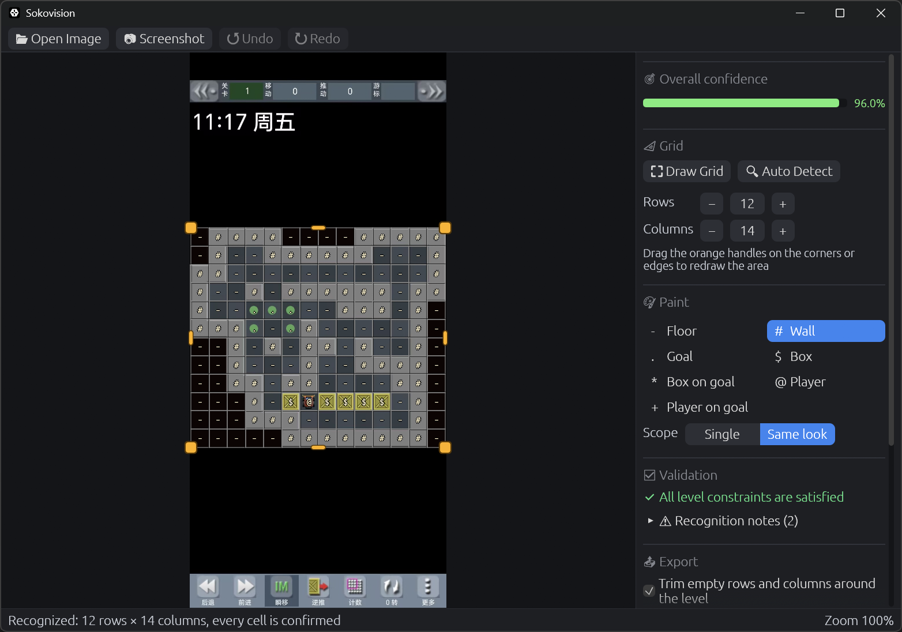

# sokovision

Recognize [Sokoban] boards from screenshots and export them to [XSB] format.

<p align="center"></p>

## Features

- **Grid Detection**
  - **Skin-agnostic fitting**: Locates boards and cell pitches via colour-contrast edge projections, UI bar cropping, and autocorrelation fallback for lineless skins.
  - **Scale and frame resilience**: Handles fractional DPI scaling, dithered subharmonics, and letterboxed window frames, with local hill-climbing refinement.
- **Board Inference**
  - **Zero-training classification**: Groups tiles by visual appearance and solves global Sokoban constraints (wall enclosure, single player, matching box and goal counts) validated with [`soukoban`].
  - **Skin learning**: Remembers confirmed tile prototypes across levels and resolutions to accelerate and stabilize subsequent reads.
  - **Calibrated confidence**: Reports per-cell confidence scores and ranked candidate alternatives for uncertain tiles.

## Usage

### GUI

```sh
cargo run --release
```

### Library

```rust
use sokovision_core::{RecognizeOptions, image::open, recognize};

fn main() -> Result<(), Box<dyn std::error::Error>> {
    let image = open("level.png")?.to_rgba8();
    let result = recognize(&image, &RecognizeOptions::default())?;
    println!("{}", result.board().trimmed().to_xsb()?);
    Ok(())
}
```

## AI Disclosure

This project is developed entirely with LLM assistance, and no human code review has been performed.

## License

Licensed under either of

- [Apache License, Version 2.0](LICENSE-APACHE)
- [MIT license](LICENSE-MIT)

at your option.

[Sokoban]: https://en.wikipedia.org/wiki/Sokoban
[XSB]: https://www.sokobano.de/wiki/index.php?title=Level_format
[`soukoban`]: https://github.com/ShenMian/soukoban
